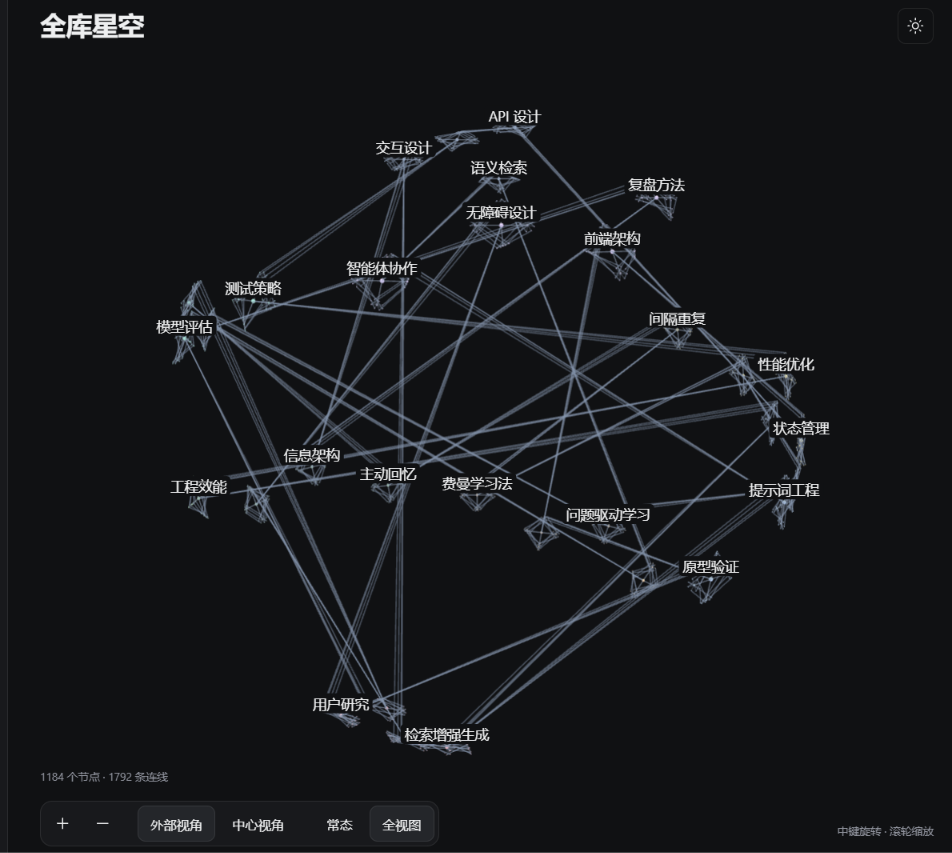
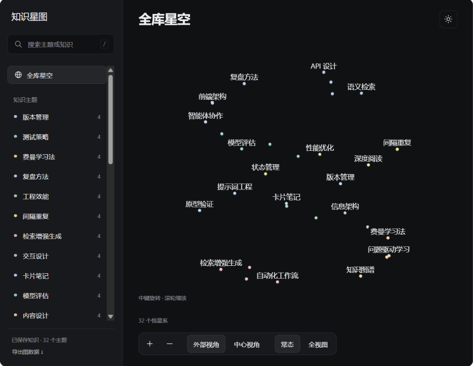
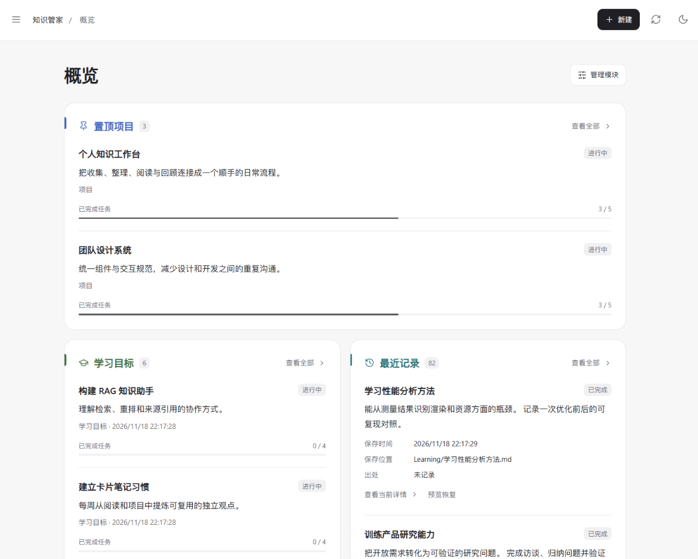
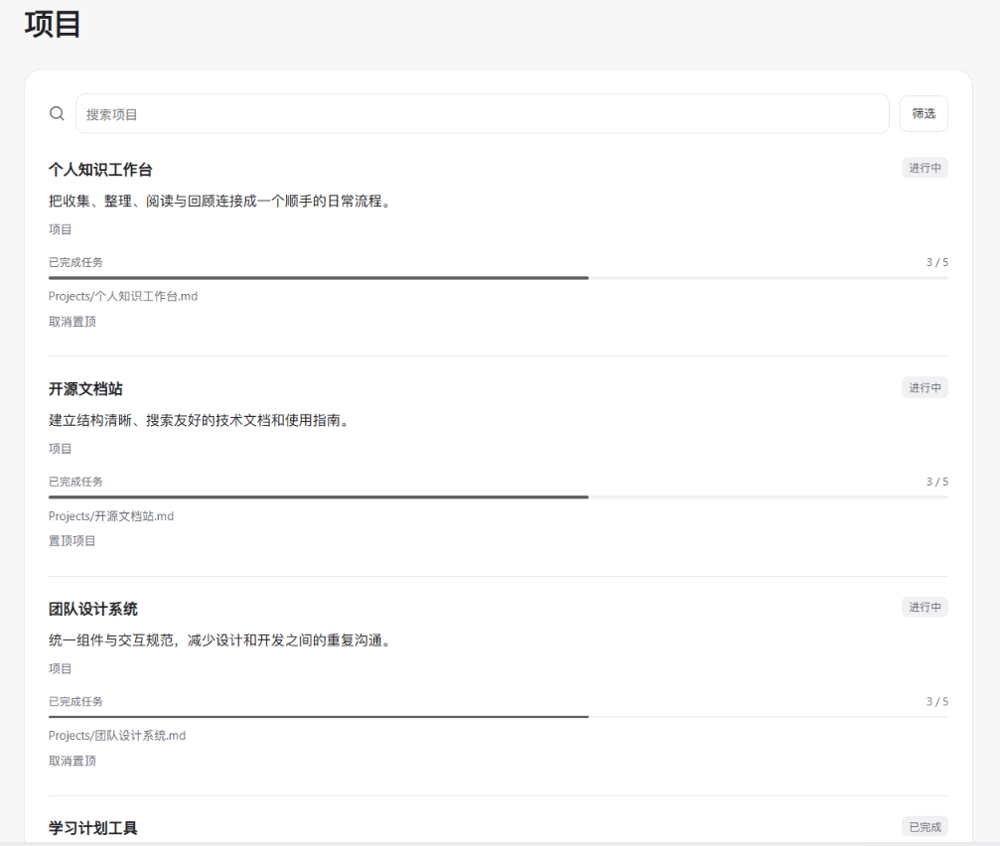
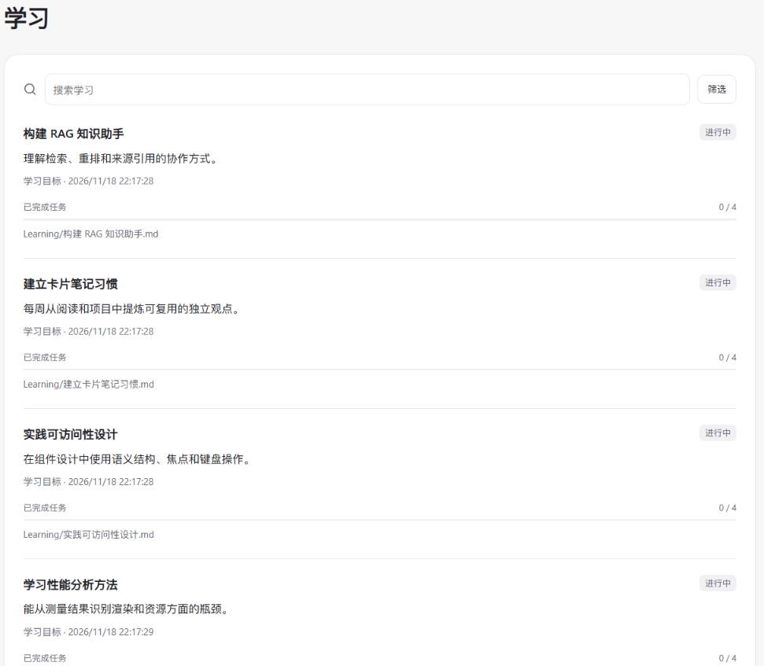

# 知识管家 · Knowledge Butler

在 Codex 中整理资料，在 Obsidian 中积累知识。

**[下载 Windows 安装包](https://github.com/lanyun077/knowledge-butler/releases/download/v0.1.0-rc.1/knowledge-butler-0.1.0-rc.1-windows.zip)** · [所有版本](https://github.com/lanyun077/knowledge-butler/releases) · [简明使用指南](docs/GETTING-STARTED.md)

## 下载安装

环境：Windows、[Node.js 24 LTS](https://nodejs.org/)、Codex 和 Obsidian。无需安装 Obsidian 社区插件。

**1. 下载并解压**上方 Windows 安装包，在解压目录打开 PowerShell。

**2. 准备运行目录**，复制执行：

```powershell
$runtime = "$env:LOCALAPPDATA\KnowledgeButler\rc1"
New-Item -ItemType Directory -Force "$env:LOCALAPPDATA\KnowledgeButler" | Out-Null
node scripts/prepare-codex-trial.mjs "$runtime"
```

**3. 准备成功后，在同一窗口安装插件**：

```powershell
codex plugin marketplace add "$runtime"
codex plugin add learning-os-trial@learning-os-trial
```

重启 Codex，在新聊天中说 **“打开知识管家”**。

[接入自己的知识库](INSTALL.md#连接已有vault) · [完整安装与验证](INSTALL.md) · [升级与恢复](KNOWLEDGE-GUIDE.md#升级与回退)

## 看见知识之间的关联

将项目、学习和零散材料整理为知识。在三维星空中搜索主题、逐层浏览，用全视图查看知识之间的关联。



<details>
<summary>查看常态：聚焦主题，按需展开</summary>



</details>

## 项目、学习，各有位置

模块化首页集中展示置顶项目、学习目标和最近记录，支持增删模块与拖动排序。项目和学习分别管理，随时查看进展。



<details>
<summary>查看项目与学习页面</summary>

**项目**：查看任务进度，置顶正在推进的工作。



**学习**：按目标组织阅读、练习与学习记录。



</details>

## 保存有出处，原文随时读

用自然语言发起收集和整理，查看保存位置与出处，在 Obsidian 打开完整笔记。资料以本地 Markdown 保存。

## 许可与反馈

采用[源码可见许可](LICENSE)，个人及企业内部日常使用免费，商业集成与付费服务需另行授权。用户笔记与生成内容不受该软件许可限制。[第三方说明](THIRD-PARTY.md) · [反馈](https://github.com/lanyun077/knowledge-butler/issues)
