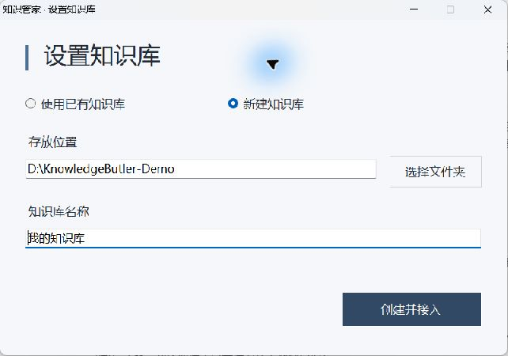
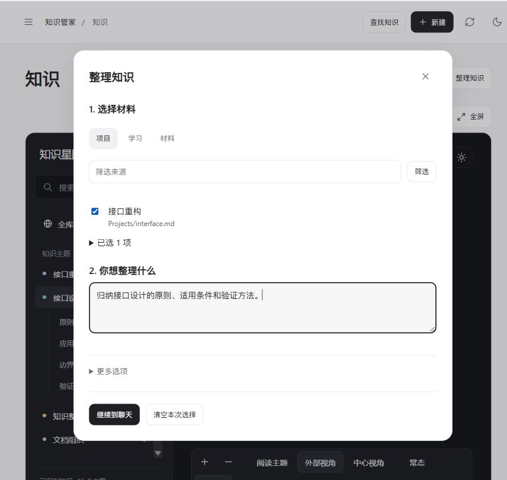
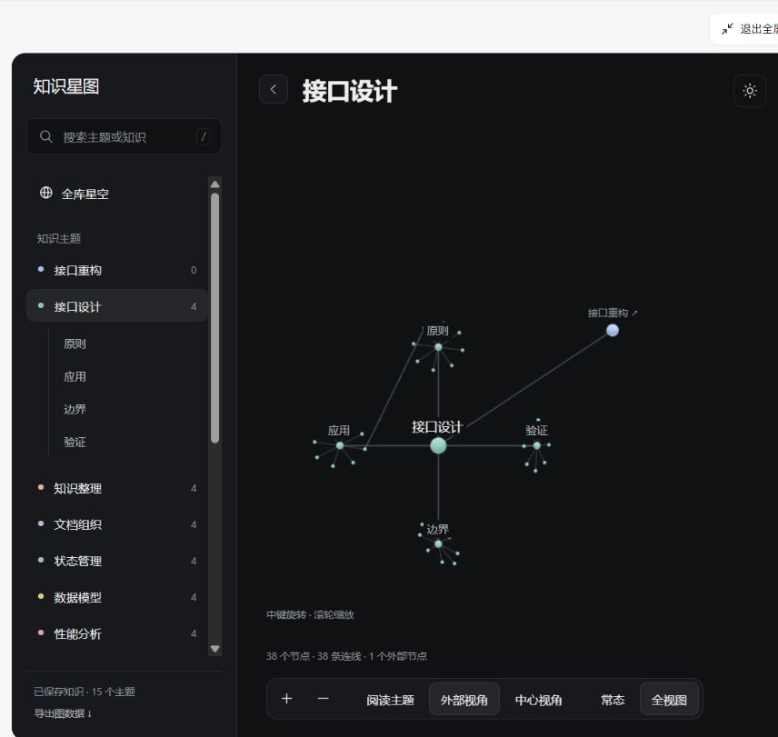

# 简明使用指南

安装见[安装说明](../INSTALL.md)。日常直接告诉 Agent：“打开知识管家”“保存这段资料”“更新项目进展”或“整理这些材料为知识”。

## 接入自己的知识库

按[配置文件接入](../INSTALL.md#通过配置文件接入)设置知识库位置。运行目录中有 **设置知识库.cmd** 时，也可双击使用图形窗口：

- **已有库**：选中整个知识库文件夹 → 接入。
- **新建库**：选择存放位置、填写名称 → 创建并接入。

完成后重启 Codex。新库还需在 Obsidian 中选择一次 **打开本地仓库 → 刚创建的文件夹**，原文跳转才能找到它。

默认目录为 Inbox、Wiki、Projects、Learning、Daily。已有库使用其他目录时，让 Agent 按[目录映射](../INSTALL.md#通过配置文件接入)调整配置，无需搬动笔记。

## 整理知识：选材料，再交给 Agent

**知识 → 整理知识 → 勾选来源 → 写整理目标 → 继续到聊天并发送。**

例如：“归纳这些材料中的接口设计原则、适用条件和验证方法，保存为知识。”常规整理不必展开“更多选项”。

等待 Agent 完成后，在 **记录 → 保存记录** 核对结果；“已发送”只表示请求发出。普通保存无需再次批准；只想看草稿时说明“暂不保存”。

## 星空：定位主题，逐层查看

- **中键拖动**旋转，**滚轮**缩放；左侧搜索定位主题。
- 点击主题进入星系，再点同一目录项收起；**小箭头**返回上一级。
- **常态**按距离简化，**全视图**显示当前范围全部节点与关联；悬停条目查看相关连线。

完整笔记从详情页点击 **在 Obsidian 打开**。重新登录后页面失去连接，回聊天说“打开知识管家”即可重新进入。
